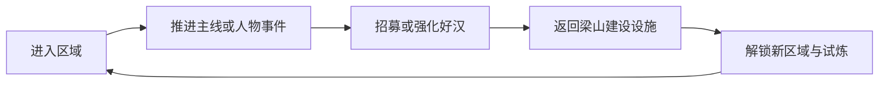

# 《星命水浒》游戏策划案

> 垂直切片美术资产、ComfyUI 生产管线与统一命名清单见 [资产包说明](docs/asset_package.md) 和 [ComfyUI 生产说明](docs/comfyui_asset_generation.md)。

**文档类型：** 立项级游戏设计文档（GDD）  
**版本：** 1.9  
**日期：** 2026-10-19  
**当前交付平台：** 浏览器版，桌面、Steam Deck 与移动端自适应  
**长期产品平台：** PC / 主机首发，移动端云游戏或后续移植  
**游戏类型：** 单机向角色收集、回合制战斗、群像叙事 RPG  
**建议分级：** 16+  
**核心卖点：** 集齐一百单八将，经营梁山，在“招安、自立、归隐”三条道路之间改变群雄命运

---

## 一、项目概述

### 1.1 一句话描述

《星命水浒》是一款以北宋末年为舞台的角色收集回合制 RPG。玩家以“星命行者”的身份游历江湖，通过结义、比武、解厄与招贤结识一百零八位好汉，经营梁山泊，并在朝廷、江湖与百姓之间作出选择，决定聚义的最终去向。

### 1.2 产品定位

| 项目 | 定位 |
| --- | --- |
| 体验结构 | 宝可梦式的探索、收集、队伍构筑与回合制对战 |
| 叙事结构 | 水浒群像、江湖冒险、势力声望与多结局 |
| 单局节奏 | 普通战斗 4 至 7 分钟，首领战 8 至 12 分钟 |
| 主要模式 | 单人剧情；可选双人协作挑战，不设强制在线 |
| 长线目标 | 收齐一百单八将、完成人物篇章、建设梁山、达成结局 |
| 付费模型 | 买断制；外观与大型剧情扩展包付费，不出售角色抽取 |
| 目标用户 | 16 至 35 岁，喜欢角色收集、回合策略、武侠群像与中等叙事密度的玩家 |

### 1.3 设计支柱

1. **人人有用，而非稀有度淘汰。** 一百零八位好汉全部可获取、可使用，低星号角色不因抽取稀有度天然弱于高星号角色。
2. **结义靠行动，不靠捕获。** 好汉有自己的目标与底线，玩家必须通过事件、战斗与选择获得信任。
3. **阵容表达优先于数值堆叠。** 站位、路数、招式、义气与人物关系共同决定战术，不把成长简化为等级碾压。
4. **梁山是持续变化的家。** 聚义厅、演武场、酒楼与水寨会随人物加入和剧情推进改变，而不是静态菜单。
5. **选择必须留下代价。** 玩家可以影响人物命运，但不能无条件拯救所有人，三条终局路线各自承担政治与情感后果。

### 1.4 与宝可梦玩法结构的对应关系

| 参考维度 | 《星命水浒》的处理 |
| --- | --- |
| 收集图鉴 | 一百零八星宿图鉴，记录人物、绰号、星号、招募条件与人物关系 |
| 探索遇敌 | 地图上的可见敌人、巡逻队与事件战，不采用高频随机踩雷 |
| 属性克制 | 四路武学循环克制，同时保留招式与阵容带来的例外 |
| 招式学习 | 武学秘籍、师承事件、人物突破与招式装配 |
| 队伍培养 | 六人队伍、三人在场、共享经验、无随机个体值 |
| 进化 | 不改变人物本体，以“命途突破”解锁新姿态、招式与剧情能力 |
| 地区道馆 | 地方势力与英雄试炼，作为区域能力检验与人物招募节点 |
| 图鉴完成 | 集齐一百零八人，并完成关键人物事件与梁山建设目标 |
| 交换与抽取 | 不做角色抽取；后续可通过共享存档中的“英雄试炼”挑战他人阵容 |

> 知识产权说明：《水浒传》人物与故事属于公版文学素材；本作只在系统结构上参考角色收集与回合对战类型，不复制宝可梦的名称、角色、美术、文本、招式表达、数值表或关卡设计。

### 1.5 当前可玩版与完整产品边界

本文件同时记录完整版产品蓝图和当前可执行版本。当前可玩版不是仅有界面的策划演示，已经具备一条从开卷到结局、可自动存档并重复挑战的完整流程：

- 九回主线战役与 28 回单机长卷、108 位可战斗好汉、3 人阵位、四路克制、义气义技与四种星命合击阵。
- 九回剧情抉择共对应 19 种「临阵战意」，每种抉择都会把叙事立场转成下一战的实际规则。玩家可在选择前看到战法，在确认页复核，并在战斗 HUD 中持续读取；首次收录获得额外铜钱与历练，跨新卷保留，未收录项由「星命路标」转成明确重游目标。
- 72 组专属「兄弟契」：保留林冲与鲁智深的受击援护、武松与戴宗的速度和破敌义气、安道全与时迁的夺气回血、花荣与张清的飞石弹射、徐宁与林冲的金枪同门，以及「三山聚义」「登州三杰」「东昌三将」「十字坡同行」等契文，并为新增好汉补齐不同水陆、文武和旧部组合。每契拥有独立战斗规则，不只是数值加成；首次胜利触发后永久录入阵谱，并给在场好汉发放首见奖励。
- 智能自动战斗、四套可持久化战法与 1x / 2x / 4x 战斗速度，可在任意回合手动接管；均衡负责综合决策，破阵偏重护势、破甲与群攻，守势提前治疗和补护御，追残集火低生命与可斩杀目标。演武自动续阵会在战报停留后采纳军师建议并进入下一阵，遇到军中奇遇则暂停。
- 沧州押差、江州行刑官、祝家庄教师与大名府都监具备不同战斗机制，不能只靠数值碾压理解精英战与首领战。
- 每位好汉有 3 项永久星命试炼，完成一项增加 2% 基础属性；试炼进度跨新卷保留。
- 每位好汉三试圆满后解锁两条「星命命途」，可免费切换但同一时间只能选择一条。命途不是纯数值皮肤，而是分别改变护御、反击、破势、夺气、治疗、暴击、残血收益与击杀续航等实战规则。
- 108 位好汉各有三段「江湖异闻」，共 324 段连续个人剧情。异闻按主线回目与前置段落依次解锁，目标直接记录对应好汉的胜场、义技和伤害；完成一段给予铜钱、专属历练与全属性 +0.5% 永久成长，新卷继承已录异闻。
- 108 场「群英列传」终章战承接三段异闻。玩家必须结义、推进到对应回目并领取完整异闻链后才能进入；每场拥有独立冲突、地点、敌阵、敌人修正、专属战意与唯一装备，胜利后永久载入群英列传，新卷仍可查阅。
- 108 帖「聚义帖」组成多层招贤脉络：杨志、公孙胜、卢俊义、张顺构成四帖递进主线；史进、秦明、柴进、关胜提供四段独立聚义故事；张清在东昌驿道以飞石断旗入伙，徐宁在东京旧校场以钩镰枪拆开民夫押阵；孙二娘、顾大嫂、凌振、阮小七、李俊与呼延灼分别以药控、反击、炮火、残血爆发、水战调度和重甲破阵作为阵容考试；刘唐、雷横、朱仝、李应、解珍与解宝组成从生辰纲风声、郓城牢门到登州双猎的六帖递进线；杨雄、石秀、孙立、乐和、萧让与蒋敬以牢城判词、屋脊追斩、雪门反击、笛声开江、临文改令与总账护仓六帖收束中后盘。新增好汉各有与旧路相连的招贤地点、取舍和阵前战意，每帖绑定关键回目，胜利后结义、获得唯一装备并永久记录。
- 19 项梁山战功、3 种结局收录、三设施经营与星图图鉴。
- 九回战役共 27 枚永久战卷评鉴：全阵而归、星命同辉、兵贵神速；章节可重游补星并获得一次性奖励。
- 梁山演武无尽模式、固定种子的每周军令、生命跨波保留、每波三选一军令、每轮一次军师变阵、同令阵眼与双路阵法、战功悬赏、每五阵轮换首领、6 道可叠选「天书星劫」、9 件永久遗物、20 项阵法图鉴与 8 种官军军势图鉴。
- 10 首 ComfyUI YuE2 无缝循环配乐，覆盖标题、江湖、聚义帖、清风寨、江州、祝家庄、大名府、普通战斗、首领战与终卷。
- 浏览器版具备 Web App Manifest、192px/512px 安装图标与生产 Service Worker。玩家可在支持 PWA 的浏览器中独立窗口安装，应用外壳和已加载素材会在断网后继续可用；开发环境不注册 Worker，正式构建通过断网刷新回归。

完整商业版仍以一百零八将、区域探索、人物事件链、3D 战斗演出、全量语音、多语言、主机移植、平台认证和发行材料为建设目标。上述目标不能被当前可玩版的完成度替代，当前版本也不应被描述为已经完成全部 108 将内容。浏览器交付的安装、离线、缓存与正式域名门禁见 [浏览器发行与安装](docs/browser_release.md)。

### 1.6 长期可玩性原则

长期乐趣来自“下一局要换一种打法”，而不是签到、体力或概率抽取。当前版本围绕以下七层循环组织重复游玩：

1. **每次抉择改写下一战。** 九回共 19 种临阵战意，救民、夺船、留证、药烟、绕后等叙事立场分别改变护御、身法、义气、控制、破势或反击规则。玩家不是读完文本后进入同一场战斗，而是在做出价值判断时同时选择一道战术题。
2. **每阵有取舍。** 三选一军令会同时改变即时战力、阵眼进度与双路阵法；军师建议给出一个可解释的稳健答案，玩家仍可为了下一座阵法逆着建议构筑。
3. **每局有路线。** 十二类军令、十二种三重阵眼与八种双路阵法形成锋、守、谋、义四类可辨认的构筑方向；八种官军军势再从敌方规则侧改写每阵题面。构筑面板会显示最近的下一座阵法以及所缺军令重数，让奖励选择始终服务于一个可见目标。
4. **失败有信息。** 战后 S/A/B 战报拆出全阵而归、速攻、悬赏与星命合击目标，失败不是单纯数值惩罚，而是告诉玩家下一局应调整站位、爆发窗口或军令路线。
5. **每周有新题。** 固定种子的周令、周悬赏与敌阵规则使用同一套可复现条件；三阶周印提供阶段目标，历史周记录保留成绩，但不以错过的限时奖励惩罚玩家。
6. **同一套阵容可以主动加难。** 「天书星劫」允许玩家在出阵前叠选至多三道风险规则，分别改写敌军生命、护甲、攻击、身法、全队回气与波间恢复。星劫不会锁住基础奖励，而是把额外军功、铜钱与历练明确标在出阵页；最高波次会逐步解锁新星劫，让玩家从“能否过关”自然过渡到“愿意承担多大风险冲分”。
7. **随时有下一步。** 「星命路标」会读取当前主线、临阵战意、角色故事、演武续局、遗物节点、评鉴缺口与结局收录，把最值得推进的两至三项直接摆在行军图上；通关页同时展示异闻、列传、兄弟契、演武、功簿与结局六条长期进度，玩家不需要在多个菜单间猜测接下来玩什么。

自动战斗与 `1x / 2x / 4x` 倍速只负责缩短重复操作，不替玩家决定奇遇、军令路线或本轮收束。四套战法让自动托管也能表达阵容偏好，但不会替代玩家对高风险节点的判断。手动接管、关闭自动战斗和逐回合指挥始终可用，构筑选择与战斗决策仍是长期乐趣的主体。

---

## 二、目标用户与核心体验

### 2.1 目标用户

- 喜欢《宝可梦》《女神异闻录》《火焰纹章》等队伍构筑游戏的玩家。
- 熟悉或好奇《水浒传》，愿意看到群像人物被重新组织成可互动队友的玩家。
- 偏爱中等规模半开放地图、明确任务目标与持续角色成长的玩家。
- 希望在单机游戏中获得收集目标、支线故事和可 replay 的战术组合，而非竞技排名压力的玩家。

### 2.2 玩家的核心承诺

- **前 10 分钟：** 获得第一位好汉，完成一次有克制关系的战斗，看到梁山星宿图被点亮。
- **前 60 分钟：** 结识三至四位好汉，第一次调整队伍与站位，并建立梁山据点。
- **前 5 小时：** 形成自己的战斗偏好，完成一条人物招募链，首次面对官府与江湖的声望冲突。
- **20 至 30 小时：** 进入梁山聚义中段，拥有十余人常用阵容，开始承担人物命运选择的后果。
- **50 至 70 小时：** 收齐主要好汉，完成梁山建设，进入三条终局路线之一。

### 2.3 体验差异

本作的收集对象是有自主意志的人，而不是可被装进容器的生物。玩家不能把好汉视为纯粹战力卡牌。若长期强迫某位好汉执行与其价值冲突的行动，其“离心”会上升，人物事件会关闭，部分终局选项也会受到影响。

人物强弱由定位、招式、命途与队伍配合决定，不设置“抽到即毕业”的稀有度壁垒。所有角色都能通过可预期的材料成长到终局可用状态。

---

## 三、世界观与叙事框架

### 3.1 时代背景

故事发生在北宋末年，朝廷腐败、赋税沉重，地方豪强与官府互相勾连。天灾、兵役与土地兼并迫使百姓流亡，江湖势力趁势扩张。梁山泊位于八百里水泊之中，既是避难所，也是各方势力争夺的交通与军事要地。

游戏不把梁山简单写成“绝对正义”，也不把官府全部写成脸谱化恶人。玩家会遇到贪官、酷吏、被迫执行命令的军士、只顾私利的江湖人，以及愿意让百姓活得更好的基层官员。选择的关键在于谁承担代价，而不是谁拥有更好的口号。

### 3.2 主角设定

玩家扮演一名没有固定出身的“星命行者”。序章中，主角在黄河渡口得到一册残缺的《天书星命录》，书中记载一百零八颗星宿与对应之人的命运。天书不能直接控制人物，只能显示其未了心结与可能遭遇。

主角不是梁山天然领袖。玩家先以外来者身份结识好汉，随后由宋江、晁盖、吴用等人共同推举进入梁山决策层。主角的独特能力是看见人物命运的分歧点，并组织众人改变一部分事件结果。

### 3.3 天书星命录

天书承担三个功能：

1. **收集导航。** 显示尚未结识的星宿、所在地域与模糊线索。
2. **人物事件追踪。** 展示好汉当前心结、招募条件和关系变化。
3. **终局记录。** 记录玩家对关键人物的影响，形成结局文本与后日谈。

天书不会直接给出正确答案。部分线索互相矛盾，需要玩家通过调查、对话与声望判断真伪。

### 3.4 三条核心声望轴

| 声望轴 | 增长方式 | 主要用途 | 冲突 |
| --- | --- | --- | --- |
| 民心 | 救灾、除害、减轻赋税、保护百姓 | 解锁民间线索、获得粮草与隐藏盟友 | 与官府合作过深时可能下降 |
| 官望 | 平乱、交差、保护城池、与官员谈判 | 进入官府区域、招安谈判、获取军械 | 向官府让步会引发部分好汉离心 |
| 江湖义望 | 比武守约、替人出头、援助山寨 | 招贤、建立联盟、解锁江湖人物 | 过度扩张会引来朝廷围剿 |

梁山内部另有“兄弟义气”与“秩序”两项隐性指标：

- **兄弟义气：** 影响人物冲突事件、聚义连携与终局是否分裂。
- **秩序：** 影响梁山治理、资源产出与百姓支持。义气高但秩序低会触发劫掠与内斗事件。

### 3.5 终局路线

1. **招安路线。** 梁山接受朝廷招安，由玩家决定是替朝廷平乱后交出兵权，还是借招安进入权力中心清除腐败。此路线强调政治博弈与内部信任。
2. **自立路线。** 梁山控制水泊与周边州县，建立新的地方秩序，抵抗围剿。此路线强调资源、民心与军事防守。
3. **归隐路线。** 玩家放弃天书，分散梁山势力，让部分好汉隐姓埋名。此路线需要满足高义气、低官望与特定人物事件条件，强调牺牲与幸存。

每条路线均不是默认“真结局”。结局质量取决于人物存活、梁山设施完成度、百姓评价与关键关系，而不是单一选项。

### 3.6 叙事基调

- 江湖场景保留豪爽、幽默与兄弟情，避免持续压抑。
- 官场与战争段落采用克制、冷峻的叙事节奏。
- 不美化滥杀、酷刑、逼婚、食人等原作黑暗内容，也不把这些内容当成猎奇卖点。
- 女性好汉拥有独立目标、战斗能力与关系线，不作为奖励或收集附庸。
- 暴力表现以战术动作和后果为主，减少对肢解、虐杀等画面的直接展示。

---

## 四、核心体验循环

### 4.1 五分钟循环


### 4.2 三十分钟循环



### 4.3 长期循环


### 4.4 单次游玩节奏建议

- 每 10 至 15 分钟设置一个可见奖励或新信息。
- 每 30 至 45 分钟出现一次队伍调整或新招式选择。
- 每 60 至 90 分钟完成一条小型人物事件或区域目标。
- 每个大章节结束前提供一次可回看的命运抉择，并明确展示主要影响。
- 允许玩家随时返回梁山，不把回城设计成消耗性道具。

### 4.5 可重复游玩与长线乐趣

主线不是唯一留存来源。玩家完成首轮后，需要能立即进入一套“阵容理解、构筑选择、波次挑战、纪录刷新”的重复循环：

- **梁山演武：** 无尽波次挑战，生命跨波保留，阵亡好汉不会自动复归。
- **临阵战意：** 每回剧情抉择绑定两种不同开局规则，例如「回身护民」给全队开场护御与减伤，「借船横江」提高身法并增加开场义气，「药烟迷阵」让敌军开场眩晕，「绕后夺炮」同时提供暴击与敌方破甲。每条路线都要在叙事立场与下一战解法之间取舍；首见收录、一次奖励与 19 种战意收集，使同一章节值得换一种选择重走。
- **军令构筑：** 每破一阵从三张军令中选一张，攻击、护御、身法、义气、治疗、破势与路数克制可以叠加成不同流派。
- **兄弟契编成：** 三十八组双人/三人阵容契文把“换人”从数值调整变成战斗规则变化。风雪同袍会在受击时互相援护，行者神行把武松破敌转化为全队义气，妙手相济让时迁夺气触发安道全救治，黑风箭雨强化花荣与李逵的群体攻势；及时定策、红锦护义、燕影青锋与智勇双星则围绕宋江、吴用、扈三娘和燕青形成新的开局与追击组合；病关拼命、登州三杰、文算双星与江风夜调进一步覆盖半血救援、破敌护队、控制延展和补气护援。首次实战触发后永久入册，形成独立于军令图鉴的阵容收集目标。
- **三重阵眼：** 同一军令累计选择三次会觉醒专属阵眼，例如铁壁令获得额外减伤、破阵令使敌军开局损失护势、聚义令强化星命合击。玩家需要在“继续加深”与“转开第二路线”之间取舍。
- **双路阵法：** 两路军令各取二重会结成一阶阵法，包括摧锋、仁壁、风雷与星火。阵眼与阵法分别鼓励专精和混搭，避免每局只堆同一条属性。
- **战功悬赏：** 每阵随机追加全阵而归、兵贵神速、三星同辉、摧锋夺势或义气纵横等可选目标。达成后获得额外铜钱与军功，结算显示完成状态，不阻断主力奖励。
- **军功纪录：** 波次、存活人数、合击次数、速攻与悬赏共同换算为本轮军功；永久保存最高军功与累计悬赏，为无尽模式提供区别于最高波次的第二冲分轴。
- **每周军令：** 以 ISO 周作为全球统一种子，固定当周四条军令、三条悬赏、一项敌阵规则与 900 / 2400 / 5200 三阶周印。每周构筑题不同；每轮可请军师变阵一次，变阵结果同样由周种子固定，既不破坏同周可比性，也给坏牌一次可控修正。个人周军功与历史周印跨重启保存。
- **天书星劫：** 出阵前可自愿叠选至多三道风险规则。黑云压城提高敌军生命，铁壁官阵提高护甲与身法，夺气妖风削弱全队回气，断粮绝道压低波间恢复，星火劫营强化高速火攻，十面埋伏则同时抬高生命、攻击与护甲。第 0、4、8、12、16、20 阵逐级解锁，每道星劫都同步提高军功，并分别增加铜钱或历练；首次携星劫出阵、最高完成波次与最高星劫军功永久记录。该层让同一套已成型阵容仍有继续挑战的理由，也让玩家能按自己的熟练度控制难度。
- **永久阵法图鉴：** 12 种阵眼与 8 种阵法首次触发后永久收录，演武界面直接展示收集进度，并为两项长期战功提供目标。新增联星、齐射、追亡与玄甲四类军令，分别服务合击、群攻、破势与守正反击流派。
- **官军军势：** 8 种军势从第 1 至第 7 阵逐级解锁：拒马铁阵提高护御，雁行齐射鼓舞后阵，狼骑突阵强化先手，连环战营在官军阵亡时强化余部，火油伏阵令梁山开局流血，雪夜劫营改变行动顺序，背水死士以低生命换取高攻击，封穴隘口短暂切断义气循环。军势在出阵前预告，战斗中常驻 HUD，并为本阵提供 8% 至 18% 额外军功；每周军令与无尽演武都由存档种子确定性生成，同时避免连续重复。首次击败后永久收入演武图鉴，并为“八阵尽观”战功提供目标。
- **跨重启续局：** 当前阵、生命比例、军令、悬赏与军功写入存档，关闭游戏后仍能从“继续当前演武”接上，不因一次退出损失整轮构筑。
- **星命连携：** 同场让三种不同路数依次出招可蓄满连携槽，玩家可在下一次我方行动主动发动全体合击。重复路数会刷新原记录，不占新槽；编成页预演本阵可结阵式，战斗 HUD 显示已记录路数与下一步提示。天罡破军、百鸟穿林、铁壁镇岳与风雷惊阵分别提供破甲、流血、护阵治疗和控场回气，首次触发会永久录入四象合击谱，自动战斗也会按当前路数自动释放对应阵式。
- **星命遗物：** 第 3、5、8、10、15、20、25、30、40 阵分别永久解锁一件遗物，提供开局义气、生命、身法、克制、攻防、暴击、破势与综合强化，形成跨局目标。
- **首领节点：** 每五阵出现首领级强敌，沧州押差与江州行刑官按轮次交替坐镇，并各自拥有半血阶段，促使玩家重新审视阵位、义气保留与治疗节奏。
- **星命试炼：** 每位好汉完成胜场、义技与击杀目标后获得永久属性成长，把重复使用冷门人物转化为可见的长期进度。
- **江湖异闻：** 每位好汉拥有三段连续个人故事，分别检验携其出战、在战斗中发动义技和累计输出。异闻不是独立菜单里的数字任务，而是把旧枪残缨、六和听钟、十字坡夜话、驿路失符等人物母题接在主线节点上；每完成一段都会得到新称号、资源与 0.5% 全属性成长，让玩家为了看下一段故事主动重组阵容。
- **群英列传：** 三段异闻完成后，好汉会迎来一场不可重复领取奖励的专属终章战。林冲夺回被篡改的旧营名册，鲁智深守住废寺流民，武松拆穿借虎患敛财的差役，张清在东昌城头连断四面令旗，徐宁在东京旧校场拆开民夫押阵，108 人各有独立场景、敌阵与冲突。每场终章都有显式战意：林冲半血守阵、鲁智深全队护御、戴宗火牌提速、时迁命中夺气、花荣无视站位、张清飞石弹射、徐宁钩镰溅射、刘唐残血追刀、朱仝反击护囚、雷横跃阵破甲、李应飞刃夺气、解珍猎杀续守、解宝夹击破势、杨雄反击传义、石秀越阵处决、孙立铁门反击、乐和补气护援、萧让状态延展与蒋敬预破护势等，必须在战斗 HUD 中提前读懂并据此调整出招。终章奖励包含唯一装备，并把整条人物线收录为永久列传。该层设计把“刷目标”收束成一次有叙事回报的阵容考试。
- **星命命途：** 三试圆满并非成长终点，而是为角色开启两条互斥打法。林冲可在「禁军铁壁」的护御反击与「雪夜孤枪」的残血追杀间切换，鲁智深可在团队抗控与罗汉破势间选择；其余十四人也分别获得控制、夺气、治疗、暴击、群体护势、开局蓄义或击杀续航方向。命途免费切换，让玩家针对首领、演武周令和阵容契重新回答“这名好汉今天该怎么用”。
- **阵容发现价值：** 兄弟契在编成页完整公开条件，战斗中在顶部显示当前生效契文，战后首次触发时发放一次性铜钱、历练并写入阵谱。108 位好汉可通过 72 种契文反复组成不同三人队，验证主动触发、开局效率和队伍功能的组合。
- **梁山功簿：** 战役、演武、人物命途、阵法与军势图鉴、经营、战卷评鉴与多结局共同驱动 19 项永久战功，完成时立刻发放铜钱与全队历练；未完成项直接显示当前计数、目标与进度条，让长期追求始终可解释。
- **星命路标：** 系统按当前存档从主线、聚义帖、异闻、列传、评鉴、演武、遗物、兄弟契、命途与结局中筛选两至三项最值得推进的目标，并提供对应入口。标题页提示首选目标，行军图保留近期路线，结局页则展示六条长期收集进度与三个可操作的继续方向。
- **战卷评鉴：** 每回设置全阵而归、星命同辉、兵贵神速三枚评鉴，分别检验生存、合击使用和回合效率；评鉴跨周目保留，让主线重游拥有不同于刷资源的战术理由。
- **失败价值：** 失败后可以重试当前阵，也可以收束本轮并保留最高波次、累计破阵和奖励。
- **新卷继承：** 重开新卷保留已解锁结局和演武纪录，但章节、人物养成与资源重新开始。
- **自动与倍速：** 重复战斗支持智能自动和 1x、2x、4x 倍速。均衡、破阵、守势、追残四套战法分别改变目标评分、治疗阈值、护御与爆发时机，战斗中可用按钮或 `T` 键即时轮换；演武自动续阵负责跨阵选择军师荐令，但每逢军中奇遇或玩家手动暂停都会停下；首次关键战仍鼓励手动接管。

演武的设计目标不是无限堆高敌人数值，而是让玩家在每一轮做出至少一次有感知的构筑决策，并用更高波次验证阵容理解。无尽局负责“把一套构筑推到极限”，周令负责“每周重新回答一道有限题”，两者共同避免长线模式退化成固定最优解。

---

## 五、世界结构与探索

### 5.1 地图结构

游戏采用“区域枢纽加半开放路线”的结构，而不是一张无缝超大地图。每个区域有主村落或城镇、两至四条探索路线、一处英雄试炼和若干人物事件。

| 区域 | 视觉与玩法重点 | 主要势力 | 代表性事件 |
| --- | --- | --- | --- |
| 黄河渡口 | 教程、流民、夜渡与基础追踪 | 流民、私盐客 | 天书现世，结识首位好汉 |
| 东京汴梁 | 繁华与压迫并存，情报、官场与市井 | 朝廷、禁军、商帮 | 林冲遭陷，高俅势力登场 |
| 郓城与梁山泊 | 水寨、芦苇荡、船战与据点建设 | 梁山、地方官府 | 智取生辰纲，初上梁山 |
| 沧州 | 雪原、军道、流放与追捕 | 禁军、沧州牢城 | 雪夜上梁山，人物命运分歧 |
| 江州 | 江面、渔村、牢狱与法场 | 江州官府、浔阳江势力 | 江州劫法场，李逵与张顺登场 |
| 大名府 | 城池、军营、潜入与守城战 | 大名府、梁山 | 攻打大名府，救援与取舍 |
| 祝家庄 | 盘陀路、机关、村落防御战 | 祝家庄、扈家庄、李家庄 | 三打祝家庄，扈三娘招募 |
| 曾头市 | 骑兵巡逻、夜袭、平原战 | 曾头市、金国商队 | 曾头市之战，晁盖命运分歧 |
| 江南 | 水乡、方腊势力、终局战场 | 方腊军、梁山、朝廷 | 招安或自立路线的高潮 |

### 5.2 探索规则

- 敌人在大地图上可见，拥有巡逻路线、警戒范围和阵营标识。
- 玩家可选择绕行、偷袭、正面交战或利用地形制造优势。
- 连续战胜同一区域敌人会提高警戒值，触发精英巡逻或首领追击。
- 战斗后敌群不会无限刷新；资源主要来自固定宝箱、任务、敌人首次击败与基地产出。
- 每个区域设有一项“地方难题”，例如水匪、瘟疫、粮荒或冤案。解决方式不止战斗一种。

### 5.3 旅行与交通

- 步行：发现人物与采集资源。
- 马匹：提高官道移动速度，部分山路不可使用。
- 船只：进入水泊、江河与隐藏岛屿。
- 传送：只在已激活的驿站或梁山渡口之间使用，避免破坏区域探索。

### 5.4 时间与天气

游戏使用昼夜与天气，但不设置严苛的时间限制。

- 夜晚：部分人物事件、盗窃路线与鬼怪传闻出现。
- 雨天：火器与火攻效果下降，水路移动加快。
- 雪天：移动减速，枪棒类反击招式获得额外效果。
- 大雾：远程命中下降，潜入更容易。

天气每 20 至 40 分钟自然变化，也可通过部分军师技能或剧情固定。玩家可在梁山星台查看下一时段预报。

---

## 六、好汉获取与星宿图鉴

### 6.1 获取原则

一百零八位好汉全部可获取，且不通过付费抽取。人物获取是任务链的结果，不是随机掉落。

招募链通常包含四个阶段：

1. **闻名。** 通过传闻、主线或星宿图鉴得知人物。
2. **相遇。** 在地图中找到人物，触发一段有明确冲突的事件。
3. **试炼。** 比武、救援、调查、物资筹备或立场选择。
4. **结义。** 完成心结条件后加入梁山，解锁人物卡、专属事件与战斗能力。

### 6.2 五种招募方式

| 方式 | 示例 | 设计目的 |
| --- | --- | --- |
| 以武会友 | 与武松在景阳冈外比试，在不使用回复道具的条件下撑过五回合 | 检验玩家对战斗系统的理解 |
| 解厄相救 | 在沧州牢城营救林冲，选择承担官府通缉或伪造文书 | 让玩家承担立场代价 |
| 声望招贤 | 民心达到要求后，李应愿意开放李家庄粮道 | 将区域行为转化为人物关系 |
| 心结抉择 | 扈三娘要求玩家先处理祝家庄与扈家庄的冲突 | 让人物加入与叙事选择绑定 |
| 梁山派遣 | 建造酒楼后派遣燕青、戴宗打探消息，触发千里寻人任务 | 利用基地与人物关系形成长期目标 |

### 6.3 获取节奏

| 游戏阶段 | 可获取人数 | 主要来源 |
| --- | --- | --- |
| 序章至第一章 | 6 至 8 人 | 主线核心与教学人物 |
| 第二章 | 累计约 18 人 | 区域主线、可选支线 |
| 第三章 | 累计约 36 人 | 梁山聚义、地方势力 |
| 第四章 | 累计约 60 人 | 城池攻防、招贤事件 |
| 第五章 | 累计约 84 人 | 终局前支线、隐藏人物 |
| 终局准备 | 108 人 | 星宿追踪、二周目补完 |

主线只要求约 48 位好汉参与关键战斗，其余人物通过支线、基地和挑战加入。这样既保证主线可完成，也保留收集空间。

### 6.4 防错过机制

- 关键好汉不会永久错过。剧情冲突后仍可通过“余波事件”再次招募。
- 星宿图鉴会明确标记“当前不可招募”的原因，但不直接显示剧透答案。
- 终局前提供“聚义追索”阶段，集中处理未完成人物线索。
- 二周目保留图鉴信息与部分基地等级，允许走不同声望路线补齐人物事件。

### 6.5 人物内容分层

| 层级 | 人数 | 资源规格 |
| --- | --- | --- |
| 核心群像 | 36 位天罡 | 独立模型、完整招募链、三至五段人物事件、专属义技演出、至少两套服饰 |
| 江湖群像 | 108 位好汉 | 独立模型、三段人物异闻、专属招式与终章列传 |
| 聚义群像 | 32 位地煞 | 独立模型与战斗定位、一段招募事件、简短心结事件 |

所有七十二地煞均可在战斗中使用，并拥有至少三个主动招式和一个被动。差异来自招式机制、站位适配与人物关系，而不来自低人一等的稀有度标签。

### 6.6 无重复角色设计

- 已招募好汉不会重复获得。
- 人物事件奖励不采用随机角色碎片。
- 挑战奖励用于解锁招式、命途材料、服饰与基地装饰。
- 若未来增加新版本角色，使用剧情招募或明确售价，不进入随机抽取池。

---

## 七、成长系统

### 7.1 五维属性

| 属性 | 作用 | 初始范围建议 |
| --- | --- | --- |
| 体魄 | 最大生命值 | 450 至 750 |
| 武力 | 物理招式基础攻击 | 70 至 130 |
| 护御 | 降低受到的伤害 | 65 至 125 |
| 身法 | 行动顺序、闪避与部分招式命中 | 70 至 130 |
| 心术 | 状态命中、策略招式威力与义气效率 | 65 至 125 |

不设置随机个体值、性格随机加成或抽取突破。人物强度曲线固定，差异由可重置换的命途、招式与装备决定。

### 7.2 等级与武学境界

- 等级上限 60。
- 每 10 级进行一次武学境界突破，共六阶：初窥、熟习、精通、贯通、化境、天罡。
- 突破需要完成对应人物事件或击败试炼首领，不能只靠刷经验。
- 队伍共享经验；替补获得 70% 经验，避免频繁换人导致断层。
- 等级差带来的伤害修正被限制在 ±20% 内，防止低级角色完全无法使用。

### 7.3 命途树

每位好汉拥有三条命途分支：

- **本职：** 强化人物最擅长的战斗定位，容错最高。
- **变招：** 改变招式用途或伤害类型，形成非传统构筑。
- **人物：** 依据人物经历解锁独特效果，需要完成人物事件。

命途点通过境界突破与人物事件获得。洗点免费，但只能在梁山演武场进行，鼓励玩家试验阵容。

### 7.4 招式系统

- 每位好汉拥有一个普通攻击、一个被动、六个可研习招式与一个义技。
- 战斗中可装配三个主动招式，与普通攻击组成四个命令。
- 招式包含路数、威力、目标、消耗、冷却、附加效果与动画标签。
- 部分招式需要特定站位、武器或队友才能发挥完整效果。
- 武学秘籍可通过人物事件、首领、探索与商店获得，不通过随机掉落。

### 7.5 义结关系

每对具有人物关系的好汉拥有独立关系等级：

| 等级 | 解锁内容 |
| --- | --- |
| 相识 | 人物对话与基础属性协作 |
| 信任 | 一方陷入危险时，另一方获得小幅属性提升 |
| 同心 | 解锁聚义连携技 |
| 生死 | 连携技升级，触发终局专属后日谈 |

关系提升来自共同出战、完成双人事件和关键选择，不通过无限送礼。每章可获得的共同出战关系点有上限，避免玩家机械刷低级战斗。

### 7.6 装备与打造

装备分为兵器、护具、信物三类，每名好汉只能装备一件同类物品。

- 兵器决定普通攻击路数与基础攻击。
- 护具提供防御、抗性或站位加成。
- 信物提供人物专属效果，例如林冲的旧枪缨、武松的虎牙、吴用的羽扇。
- 装备强化只增加固定属性，不出现随机词条。
- 高阶装备需要首领材料与工匠人物，强调基地建设与人物网络。

### 7.7 成长占比目标

在同等操作与阵容下，终局角色强度来源建议控制为：

| 来源 | 战力占比 |
| --- | --- |
| 等级与境界 | 30% |
| 招式与命途 | 30% |
| 装备 | 20% |
| 义结与连携 | 15% |
| 基地与料理增益 | 5% |

该比例用于防止单一系统膨胀，也为不同玩家保留成长路径。

---

## 八、回合制战斗系统

### 8.1 战斗形式

- 双方各上阵三名好汉，各带三名替补，最多六人。
- 三人在场时使用前阵、中军、后阵三个站位。
- 战斗以速度排序，每名角色每回合执行一个主要行动。
- 普通战斗目标时长 4 至 7 分钟；首领战 8 至 12 分钟。
- 支持手动、半自动与全自动。自动战斗只用于重复刷取，不参与首次首领解锁。

### 8.2 站位

| 站位 | 效果 | 主要风险 |
| --- | --- | --- |
| 前阵 | 受到近战攻击概率提高，护御 +10% | 容易被集火与控制 |
| 中军 | 无额外修正，可支援前后 | 缺少明显优势 |
| 后阵 | 受到近战攻击概率降低，心术 +5% | 更容易被策略与范围招式命中 |

近战招式默认优先攻击前阵；前阵无人时才能直接攻击中军。弓弩、策略与部分范围招式可以越过站位，但会受到距离或威力修正。

换位消耗一次行动。换上场的替补获得 20% 义气，但本回合受到的伤害提高 10%。

### 8.3 行动顺序

基础行动值：

```text
行动值 = 身法 × (1 + 装备与状态修正)
```

行动值高者先行动。相同行动值时，依次比较站位、队伍行动顺序编号与随机数。控制效果不会完全打乱后续顺序，避免连续行动导致不可恢复的失控。

### 8.4 四路武学克制

| 路数 | 典型表现 | 克制对象 | 被克制对象 |
| --- | --- | --- | --- |
| 刚猛 | 刀斧、枪棒、重击、破阵 | 守御 | 韬略 |
| 灵巧 | 轻功、暗器、连击、追击 | 韬略 | 守御 |
| 韬略 | 军阵、计策、削弱、调度 | 刚猛 | 灵巧 |
| 守御 | 盾阵、擒拿、反击、保护 | 灵巧 | 刚猛 |

伤害修正：

- 克制：×1.20
- 被克制：×0.85
- 同路：×1.00

克制关系作用于招式，而不是整个人物。一个角色可以同时拥有两种路数的招式，但只有本命路数享受人物被动加成。这样既保留相克判断，也避免“角色属性决定全部”。

### 8.5 伤害公式

```text
基础伤害 =
  招式威力
  × (攻击属性 / 防御属性) ^ 0.65
  × 境界系数
  × 路数系数
  × 状态系数
  × 暴击系数
  × 随机浮动 0.95 至 1.05
```

说明：

- `招式威力` 普通招式约 70 至 130，义技约 150 至 220。
- `攻击属性` 与 `防御属性` 根据招式类型选择武力/护御或心术/护御。
- `境界系数 = 1 + (攻方境界 - 守方境界) × 0.03`，限制在 0.80 至 1.20。
- 暴击基础伤害为 ×1.50，暴击率由身法与招式决定，硬上限 50%。
- 治疗公式使用心术与目标最大生命值，不产生随机浮动。

数值示例：

```text
招式威力 100
武力 110 / 护御 100
境界系数 1.00
克制系数 1.20
状态系数 1.00
暴击系数 1.00
随机值 1.00

伤害 = 100 × (110 / 100) ^ 0.65 × 1.20
     ≈ 100 × 1.063 × 1.20
     ≈ 127.6
```

### 8.6 义气与义技

- 每名好汉拥有独立义气条，范围 0 至 100。
- 造成伤害、承受伤害、成功保护队友、触发连携与击败敌人都会获得义气。
- 使用义技消耗 100 义气。
- 义技通常是人物身份的核心表达，但不应无条件成为最高伤害招式。
- 部分义技偏向救援、改变站位、清除控制或改写行动顺序。

义气获取示例：

| 行为 | 义气变化 |
| --- | --- |
| 使用普通招式命中 | +8 |
| 受到一次有效伤害 | +6 |
| 保护队友并承受伤害 | +12 |
| 触发聚义连携 | 双方 +15 |
| 队友倒下 | +20，每场最多一次 |
| 使用义技 | -100 |

### 8.7 聚义连携

- 两名关系达到“同心”的好汉同时在场可解锁连携。
- 连携每场战斗限一次，不消耗额外回合，但占用发起者本回合行动。
- 连携拥有独立演出、路数组合与战术效果。
- 连携强度不随角色数量无限叠加，避免最优解固化为固定配对。

示例：

| 连携 | 参与者 | 效果 |
| --- | --- | --- |
| 风雪夜归 | 林冲、鲁智深 | 林冲反击后由鲁智深追击，降低敌方前阵护御 |
| 打虎双雄 | 武松、李逵 | 对单体连续攻击，若目标生命低于 30% 则提高处决伤害 |
| 智取生辰纲 | 吴用、阮小七、刘唐 | 对敌方后阵施加混乱并夺取义气 |
| 江州法场 | 宋江、戴宗、李逵 | 清除全队控制，并为濒死队友提供护盾 |

当前可玩版实现通用“星命连携”：同场出招会按路数去重并保留最近记录，重复路数刷新原记录而不占新槽；三种不同路数齐备后，下一次我方行动由当前好汉发动一次全体合击。连携不消耗义气，但会结束发起者本回合行动；玩家可等待更合适的时机，自动战斗则在蓄满后的下一次我方行动立即释放。编成页会预演本阵可结阵式，战斗 HUD 显示路数进度与具体下一目标，使“换人换路数”的构筑决策在战前、战中、战后都有连续反馈。

### 8.8 状态效果

首版控制状态控制在六类，避免战斗信息过载：

| 状态 | 效果 | 持续 | 抗性规则 |
| --- | --- | --- | --- |
| 破甲 | 护御降低 20% | 2 回合 | 可叠加两层 |
| 流血 | 行动后损失最大生命 4% | 3 回合 | 不叠加，刷新持续 |
| 眩晕 | 跳过下一次行动 | 1 次 | 同一目标 2 回合内抗性提高 |
| 封穴 | 无法使用义技与指定招式 | 1 回合 | 首领拥有阶段免疫 |
| 灼烧 | 受到伤害提高 10%，治疗降低 30% | 2 回合 | 与流血可共存 |
| 鼓舞 | 武力与护御提高 12% | 2 回合 | 同队不可重复叠加 |

控制命中率：

```text
最终命中率 =
  招式基础命中率
  + (施放者心术 - 目标心术) × 0.003
  - 目标控制抗性
```

最终命中率限制在 15% 至 95%。连续控制同一目标时，每次额外降低 25% 基础命中率。

### 8.9 首领破势

首领拥有独立“势”条。玩家使用克制路数、连携与义技可削减势值。势值归零后，首领进入两回合破势状态：

- 受到伤害提高 25%。
- 行动顺序延后。
- 无法使用当前阶段的强力招式。
- 破势结束后获得短时间控制抗性。

破势不是简单血条延后，而是要求玩家在阶段内调整阵容、保留义技并处理小怪。

当前可玩版另有四组已落地的首领阶段机制：

- **沧州押差“困兽反扑”：** 首次降至 50% 生命时恢复 14% 最大生命，获得两层护御与鼓舞，并在该阶段降低后续受到的伤害。
- **江州行刑官“朱笔断令”：** 首次降至 50% 生命时充满义气，为全队施加流血与破甲，并在该阶段提高自身伤害。
- **祝家庄教师“死守粮仓”：** 以盘陀夹枪与庄门火把交替压迫前中阵，并会在战局拉长后自守粮仓、叠加护御，逼玩家把破甲与破势集中到正确窗口。
- **大名府都监“闭城死战”：** 以断门刀、灯市伏兵与朱笔勾名构成多段威胁；进入后半阶段后封锁退路并强化自身，考验玩家是否预留群体治疗与越阵击杀能力。

阶段只触发一次，进入时写入战斗日志。玩家可以围绕爆发、净化、护御或破势决定是否越过半血线，而不是无条件把伤害留到义技。

### 8.10 战斗 AI

- 敌方优先攻击可被击败、被克制或正在蓄力的目标。
- 精英敌人会根据队伍站位改变招式。
- 首领使用脚本化阶段与条件分支，不采用纯随机出招。
- 玩家队伍支持自定义自动战斗规则，例如优先治疗、保留义技、集中前阵。
- 当前可玩版本提供四套智能自动战法。均衡综合治疗、护御、路数克制与残血收益；破阵优先前阵、高护势、破甲与群攻；守势使用更高的治疗阈值，先补护御和义气，避免在阵线健康时提前交伤害绝技；追残优先低生命、可斩杀与单体收割目标。战斗顶部按钮和 `T` 键都可轮换，选择写入存档。
- 自动战斗可随时关闭并手动接管，也可在 1x、2x、4x 三档速度间切换。
- 自动续阵只自动处理阵后三选一军令，不替玩家决定奇遇、收束本轮或关键剧情选择。

### 8.11 临阵战意

临阵战意把剧情选择转换成战斗规则，避免“选完文本，战斗照旧”。当前九回共 19 种战意，每回对应剧情选项各一种，终回三种：

| 设计层 | 处理 |
| --- | --- |
| 叙事映射 | 选项表达玩家优先救谁、保什么或冒何种风险；战意名称与描述沿用同一立场，不把选择伪装成纯数值选项 |
| 规则映射 | 效果只使用现有战斗状态与修正器，包括护御、减伤、身法、义气、暴击、破势、治疗、反击、眩晕、破甲、鼓舞和敌方初始护势 |
| 预告链路 | 抉择卡显示战意，确认页再次核对，战斗 HUD 常驻显示名称与规则，胜利页记录收录 |
| 收集反馈 | 首次收录发放随章节递增的铜钱与历练；重复选择不重复领奖，战意跨新卷保留 |
| 重游导航 | 未收录战意进入「星命路标」；行军图按章节显示收录进度，直接说明另一条抉择会带来什么 |

设计约束是“易懂但改变出招顺序”，而不是叠加隐藏百分比。例如敌军开场眩晕必须直接改变首回合目标；身法与义气必须让玩家更早换位或发动义技；护御与反击必须支持前阵承伤。任一效果都要能在战斗日志与 HUD 中找到对应信息。

### 8.12 新手示例战

**关卡：** 野猪林伏击  
**敌方：** 两名持刀差役在前阵，一名弓手在后阵  
**己方：** 林冲、鲁智深、戴宗

| 回合 | 玩家目标 | 教学重点 |
| --- | --- | --- |
| 1 | 鲁智深使用“禅杖横扫”攻击前阵，林冲蓄力反击 | 前阵保护与破甲 |
| 2 | 戴宗使用“神行传令”把林冲移到后阵，避开弓手集火 | 站位与换位成本 |
| 3 | 林冲触发反击，鲁智深义气满后使用义技击败前阵 | 义气与破势 |
| 4 | 敌方弓手暴露，武松作为替补登场完成追击 | 替补登场与克制 |

---

## 九、好汉设计

### 9.1 单个人物数据模板

每位好汉至少包含以下字段：

| 字段 | 说明 |
| --- | --- |
| 姓名 | 公版小说人物姓名 |
| 绰号 | 人物识别标签 |
| 星号 | 天罡或地煞星号 |
| 本命路数 | 被动加成对应的武学路数 |
| 战斗定位 | 先锋、游侠、守御、军师、医者、方术 |
| 站位偏好 | 前阵、中军或后阵 |
| 五维属性 | 体魄、武力、护御、身法、心术 |
| 被动 | 始终生效或满足条件生效 |
| 四至六个可研习招式 | 包含路数、目标、效果与动画 |
| 义技 | 100 义气释放的标志性能力 |
| 命途分支 | 本职、变招、人物 |
| 招募条件 | 事件链、声望与试炼条件 |
| 关系人物 | 可触发连携或特殊事件 |
| 心结 | 三阶段人物弧线 |

### 9.2 核心人物示例

#### 林冲

- **星号：** 天雄星
- **绰号：** 豹子头
- **定位：** 守御型反击先锋
- **本命路数：** 刚猛
- **被动“禁军枪架”：** 处于前阵时，受到近战攻击后有 25% 概率以普通攻击反击。
- **招式：**
  - 寒星枪：单体刚猛伤害，命中后施加一层破甲。
  - 回马枪：后撤并攻击目标，若本回合换位则威力提高。
  - 雪夜封喉：对生命低于 40% 的目标造成高额伤害。
  - 禁军枪阵：两回合内提高前阵护御，并将一次单体伤害转移给自己。
- **义技“风雪山神庙”：** 清除自身控制，对前方敌人连续刺击，每次命中提高反击概率。
- **命途变化：** 本职强化反击，变招转为高机动枪术，人物线解锁保护队友后的追击。

#### 鲁智深

- **星号：** 天孤星
- **绰号：** 花和尚
- **定位：** 前阵控制与群体破甲
- **本命路数：** 刚猛
- **被动“倒拔垂杨柳”：** 控制抗性提高 20%；成功抵抗控制后获得 15 义气。
- **招式：**
  - 禅杖横扫：攻击前阵全体并施加破甲。
  - 醉打山门：造成伤害并击退目标，打断蓄力。
  - 倒拔杨柳：抓取目标，使其本回合无法换位。
  - 佛门金身：短时间降低受到的法术伤害。
- **义技“拳打镇关西”：** 对单体连续三次攻击，第三次必定暴击；若目标曾伤害队友，则额外提高威力。
- **关系：** 林冲、武松、史进。

#### 武松

- **星号：** 天伤星
- **绰号：** 行者
- **定位：** 单体爆发与残血处决
- **本命路数：** 灵巧
- **被动“打虎”：** 面对生命高于自身的敌人时，首次攻击无视 15% 护御。
- **招式：**
  - 玉环步：提高身法并缩短下一次招式冷却。
  - 鸳鸯脚：对前阵和中军各造成一次灵巧伤害。
  - 醉拳：随机攻击两次，命中同一目标时追加一次轻击。
  - 戒刀斩：对流血目标造成额外伤害。
- **义技“景阳冈打虎”：** 锁定单体，无视站位阻挡；目标生命越低，暴击率越高。

#### 吴用

- **星号：** 天机星
- **绰号：** 智多星
- **定位：** 后排控制与行动调度
- **本命路数：** 韬略
- **被动“智多星”：** 开战时全队额外获得 14 义气；吴用造成的护势伤害提高 15%。
- **招式：**
  - 羽扇点将：让一名队友立即获得 20 义气。
  - 连环计：对两个目标施加破甲或封穴。
  - 诱敌深入：降低目标护御，并使其优先攻击指定前阵。
  - 借东风：改变天气效果，持续两回合。
- **义技“智取生辰纲”：** 夺取敌方全体各 20 义气，并让己方义气最低的两人各获得 30 义气。

#### 宋江

- **星号：** 天魁星
- **绰号：** 呼保义
- **定位：** 中军指挥与团队续航
- **本命路数：** 韬略
- **被动“呼保义”：** 开战时全队获得 10 义气；任意好汉本场首次降至 35% 生命以下时，宋江立即为全队恢复 8% 生命并给予 1 回合护御。
- **招式：**
  - 仗义疏财：消耗铜钱类战斗资源，为全队恢复生命。
  - 呼保义：提高全队义气获取率。
  - 招贤令：换上一名替补，并使该角色本次行动不消耗义气。
  - 忠义堂：为全队提供两回合鼓舞。
- **义技“替天行道”：** 根据当前梁山义气选择全队治疗、清除控制或提高全队下一次义技威力。

#### 扈三娘

- **星号：** 地慧星
- **绰号：** 一丈青
- **定位：** 高机动双刀控制
- **本命路数：** 灵巧
- **被动“红锦缚敌”：** 攻击破甲或破势目标时伤害提高 20%；暴击会令目标的破甲延长 1 回合。
- **招式：**
  - 日月双刀：对单体造成两段灵巧伤害。
  - 红锦套索：将目标拉至前阵并降低身法。
  - 青影步：提高闪避，并将自身移到中军。
  - 马上连环：对相邻站位各攻击一次。
- **义技“一丈青”：** 套索控制一名敌人，随后对所有被控制目标发动追击。
- **叙事原则：** 扈三娘的招募与婚姻不挂钩，人物线重点处理家族、战败与自主选择。

#### 戴宗

- **星号：** 天速星
- **绰号：** 神行太保
- **定位：** 行动顺序与全队机动
- **本命路数：** 灵巧
- **被动“神行法”：** 每场战斗首次行动额外获得 30% 行动值。
- **招式：**
  - 甲马急行：交换任意两名队友的站位。
  - 传令：使一名队友立即提前行动。
  - 千里追踪：标记目标，使全队对该目标命中率提高。
  - 神行护符：为队友提供一次移动后免控。
- **义技“日行八百”：** 让全队本回合行动顺序提前，并为每人补充少量义气。

#### 安道全

- **星号：** 地灵星
- **绰号：** 神医
- **定位：** 治疗与状态净化
- **本命路数：** 守御
- **被动“药到病除”：** 治疗生命低于 30% 的目标时，治疗量提高 20%。
- **招式：**
  - 金针渡厄：单体治疗并清除一个负面状态。
  - 药浴：为后阵提供持续恢复。
  - 麻沸散：对敌方施加眩晕，但命中率较低。
  - 妙手回春：回复目标已损失生命的一部分，冷却三回合。
- **义技“神医下山”：** 为全队恢复生命，并让所有负面状态持续时间减少一回合。

#### 时迁

- **星号：** 地贼星
- **绰号：** 鼓上蚤
- **定位：** 偷袭、偷取与后排干扰
- **本命路数：** 灵巧
- **被动“飞檐走壁”：** 从后阵攻击后，有概率回到后阵并提高闪避。
- **招式：**
  - 鼓上翻：跳到敌后阵并造成灵巧伤害。
  - 妙手空空：偷取目标义气并转移给自身。
  - 火绒：施加灼烧并破坏敌方增益。
  - 隐身：降低仇恨，下一次攻击必定暴击。
- **义技“盗甲”：** 移除目标一个增益与一个装备效果，持续到战斗结束。

#### 花荣

- **星号：** 天英星
- **绰号：** 小李广
- **定位：** 后排狙杀与多段射击
- **本命路数：** 灵巧
- **被动“百步穿杨”：** 处于后阵时暴击率提高 12%，攻击不会因目标阵位降低威力。
- **招式：**
  - 穿云箭：精准射击单体，并有概率造成流血。
  - 雁翎箭雨：射击全体敌人，对后阵目标额外提高威力。
  - 连珠三矢：对单体连续射出三箭，适合触发暴击与破势。
  - 定风一箭：钉住目标护甲，施加三回合破甲。
- **义技“小李广”：** 锁定单体射出决胜一箭，目标生命越低暴击率越高。
- **操作乐趣：** 用前阵制造安全回合，再把花荣的破甲箭与燕青、扈三娘的追击窗口叠在一起。

#### 李逵

- **星号：** 天杀星
- **绰号：** 黑旋风
- **定位：** 残血增伤与群体压制
- **本命路数：** 刚猛
- **被动“杀性”：** 生命越低造成的伤害越高，最多提高 30%；击败敌人时获得 15 义气。
- **招式：**
  - 板斧双斫：横扫全体敌人并有概率造成流血。
  - 黑风劈：重劈单体，目标生命低于 40% 时伤害大幅提高。
  - 杀声震阵：全队获得两回合鼓舞，自身额外恢复义气。
  - 舍命狂斫：连续劈砍单体两次，并强化自身杀性。
- **义技“黑旋风”：** 双斧卷起两轮旋风，对全体敌人造成两次重击。
- **风险回报：** 李逵不是无脑高攻角色。玩家需要决定何时让他承受伤害、何时用宋江或安道全把他从危险线拉回来。

#### 燕青

- **星号：** 天巧星
- **绰号：** 浪子
- **定位：** 高速暴击与后排处决
- **本命路数：** 灵巧
- **被动“浪子燕青”：** 处于后阵时暴击率提高 10%；每回合首次受到直接攻击时有 30% 概率闪避，闪避成功后获得 12 义气。
- **招式：**
  - 浪子刀：快速斩击单体并有概率造成流血。
  - 鹁鸽旋：越过前阵攻击后阵，并无视阵位减伤。
  - 相扑跌法：造成高护势伤害并有较高概率眩晕。
  - 燕尾回锋：绕过阵位重击单体，目标生命低于 45% 时威力提高。
- **义技“浪子回头”：** 踏燕三折后贯穿单体，无视阵位，目标生命越低越容易暴击。
- **操作乐趣：** 燕青把“后阵是否安全”变成主动问题。敌方直取后排时可能白吃一次闪避，玩家也可用他的越阵能力先拆弓手与军师。

### 9.3 招式数据示例

| 人物 | 招式 | 路数 | 威力 | 目标 | 冷却 | 附加效果 |
| --- | --- | --- | --- | --- | --- | --- |
| 林冲 | 寒星枪 | 刚猛 | 85 | 单体 | 0 | 施加一层破甲 |
| 林冲 | 回马枪 | 刚猛 | 95 | 单体 | 2 | 本回合换位后威力 ×1.25 |
| 鲁智深 | 禅杖横扫 | 刚猛 | 70 | 前阵全体 | 2 | 破甲一层 |
| 武松 | 鸳鸯脚 | 灵巧 | 65 × 2 | 前阵、中军 | 2 | 命中同一目标时追加 30 威力轻击 |
| 吴用 | 连环计 | 韬略 | 55 | 两个目标 | 2 | 依次施加破甲或封穴 |
| 扈三娘 | 红锦套索 | 灵巧 | 60 | 单体 | 2 | 拉至前阵并降低身法 |
| 戴宗 | 传令 | 灵巧 | 0 | 队友 | 3 | 目标立即提前行动 |
| 安道全 | 金针渡厄 | 守御 | 治疗 120 | 单体 | 1 | 清除一个负面状态 |
| 时迁 | 妙手空空 | 灵巧 | 45 | 单体 | 2 | 偷取 20 义气 |
| 公孙胜 | 五雷天罡正法 | 韬略 | 110 | 单体 | 3 | 对刚猛目标威力 ×1.2 |

### 9.4 敌方阵营

| 阵营 | 战斗特点 | 设计用途 |
| --- | --- | --- |
| 地方差役 | 数量多、护御低、会呼叫增援 | 教学与区域警戒 |
| 禁军 | 阵型完整、保护后排、枪阵反击 | 检验破阵与站位 |
| 豪强庄客 | 利用机关、陷阱与地形 | 检验探索与战场环境 |
| 水匪 | 船只移动、击退与水域优势 | 检验水战与换位 |
| 绿林山寨 | 高爆发、低持续、容易内讧 | 检验控制与集火 |
| 方腊军 | 军阵、火器、宗教鼓舞 | 终局高强度战斗 |
| 金国斥候 | 骑兵冲锋、追击与破阵 | 高机动敌人 |

---

## 十、任务与章节结构

### 10.1 任务类型

| 类型 | 时长 | 内容 |
| --- | --- | --- |
| 主线任务 | 30 至 90 分钟 | 推进时代局势与梁山聚义 |
| 人物事件 | 15 至 40 分钟 | 招募、心结、关系与命途突破 |
| 区域委托 | 10 至 20 分钟 | 除害、护送、调查、物资与战斗 |
| 英雄试炼 | 10 至 25 分钟 | 固定阵容或特殊规则的挑战 |
| 江湖异闻 | 10 至 30 分钟/段 | 好汉个人三段故事、专属目标与永久成长 |
| 基地任务 | 5 至 15 分钟 | 建设、派遣、资源与人物互动 |
| 隐藏事件 | 10 至 30 分钟 | 天气、时间、声望或人物组合触发 |

### 10.2 章节规划

| 章节 | 主题 | 主要冲突 | 章节结尾 |
| --- | --- | --- | --- |
| 第一回 黄河夜渡 | 流民与渡口 | 林冲护送流民，鲁智深出手结义 | 点亮第一批星位，建立北上目标 |
| 第二回 东京雪夜 | 禁军与高俅 | 林冲遭陷，戴宗与时迁卷入追捕 | 看清官府压迫，获得情报路线 |
| 第三回 野猪林伏杀 | 救援与代价 | 官差设伏，武松加入反击 | 梁山获得第一支可机动小队 |
| 第四回 沧州药火 | 伤病与人心 | 安道全救治伤员，押差首领困兽反扑 | 营寨医疗与后勤成型 |
| 第五回 清风寨月箭 | 地方军政 | 花荣在寨门与官军之间抉择 | 远程体系与清风山线并入梁山 |
| 第六回 江州劫法场 | 兄弟与法度 | 宋江、李逵与行刑官正面对撞 | 梁山声誉扩大，官望急剧下降 |
| 第七回 祝家庄雪夜 | 地方秩序 | 雪夜盘陀路、扈三娘与庄门守将 | 获得粮道并招募扈三娘 |
| 第八回 大名府灯夜 | 灯市与攻城 | 吴用布局、燕青潜入，都监闭城死战 | 情报与机动体系完成，朝廷正式围剿 |
| 第九回 水泊聚义 | 路线抉择 | 守梁山、争招安或散入江湖 | 三结局与后日谈 |

### 10.3 区域英雄试炼

每个大区域设置一项英雄试炼，替代传统道馆：

- 击败区域首领。
- 完成指定战术目标，例如三回合内破除敌方阵型。
- 使用至少两名该区域人物完成战斗。
- 在限制治疗次数、限制义技或限制换人的条件下获胜。

试炼奖励包括新招式、命途材料、基地图纸与星宿线索，不奖励角色抽取资格。

### 10.4 江湖异闻

每名好汉拥有三段连续个人事件，当前 108 位好汉共 324 段：

| 阶段 | 解锁 | 目标 | 叙事作用 |
| --- | --- | --- | --- |
| 第一段 | 第 1 回后与好汉结义 | 携该好汉取得 2 场胜利 | 建立人物当前困境与玩家关系 |
| 第二段 | 第 3 回后并领取上一段 | 发动 2 次该好汉义技 | 让专属战斗能力进入人物选择 |
| 第三段 | 第 5 回后并领取上一段 | 以该好汉累计造成角色定位对应伤害 | 收束旧事，获得最终称号 |

每段奖励包含铜钱与该好汉历练，并给予该好汉全属性 +0.5% 永久加成。异闻页支持单人领取与“一键领取”所有已满足条件的内容；领取状态、成长加成与前缀顺序写入存档并继承到新卷。

杨志、公孙胜、卢俊义与张顺不靠章节结算直接入队，而是各自拥有一帖招贤战：

| 好汉 | 聚义帖 | 开放条件 | 招贤战意 | 玩法作用 |
| --- | --- | --- | --- | --- |
| 杨志 | 黄泥旧约 | 第 4 回 | 全队开局护御，前阵敌人预破甲 | 教学前阵反击与破甲追击 |
| 公孙胜 | 入云问阵 | 第 5 回，且完成杨志聚义帖 | 全队护势增伤、护御与开局义气 | 验证净化、封穴与持续护阵 |
| 卢俊义 | 玉麟出府 | 第 7 回，且完成公孙胜聚义帖 | 全队攻击与前三回合暴击提高 | 验证正面破阵与满血爆发 |
| 张顺 | 白条入江 | 第 8 回，且完成卢俊义聚义帖 | 全队暴击提高，张顺获得主动闪避 | 验证后排追击与高风险身法 |

每帖先给出一处叙事取舍，再进入敌阵。胜利后只结算一次铜钱、历练与唯一装备，同时把好汉写入聚义簿；聚义记录进入存档并继承到新卷。

三段异闻全部领取后，对应好汉的「群英列传」终章战开放。当前 108 位好汉各有一场独立战斗，合计 108 场：

| 好汉 | 列传战 | 专属战意 | 叙事冲突 | 唯一奖励 |
| --- | --- | --- | --- | --- |
| 林冲 | 雪夜残旗 | 残旗不退：首次半血获得护御与义气，反击率提高 | 夺回被篡改的禁军名册，让旧部自行选择去留 | 禁军旧印 |
| 鲁智深 | 古寺钟声 | 古寺护民：全队开局护御，主角生命提高 | 护住逃入废寺的流民，击退假僧恶徒 | 百衲护衣 |
| 武松 | 冈下残酒 | 虎威压阵：前阵预破甲，击杀后全队得义气 | 拆穿借虎患勒索乡民的差役 | 景阳冈虎牙 |
| 戴宗 | 驿路火牌 | 火牌夺时：主角与全队提速，并获开局义气 | 截下加急密令，为梁山争取一夜 | 驿路火牌 |
| 安道全 | 疫营青囊 | 青囊分诊：全队治疗与开局护御提高 | 守住药棚，阻止官差焚烧病患 | 百草囊 |
| 时迁 | 百锁夜行 | 百锁留痕：命中概率附加流血并夺取义气 | 潜进军械库夺回百姓冬衣 | 百锁针囊 |
| 花荣 | 月下三矢 | 三矢定旗：暴击提高且攻击无视阵位修正 | 射断三处号旗，为清风寨打开生路 | 银梢角弓 |
| 李逵 | 黑风断后 | 断桥死战：越残血伤害越高，击杀后回血护身 | 守住石桥，让百姓与伤者先过河 | 双板黑斧 |
| 宋江 | 江州夜雨 | 江州夜雨：全队减伤并获得开局护御 | 护住受牵连百姓，让梁山成为退路 | 及时雨披风 |
| 扈三娘 | 红锦夺路 | 红锦破路：前阵预破甲，命中破甲并追加伤害 | 活捉向导，拆穿盘陀路假路与伏兵 | 红锦连环甲 |
| 吴用 | 空城灯影 | 空城灯影：全队大量开局义气并以鼓舞开阵 | 以假灯阵拖住守军，掩护赈粮离仓 | 智多星羽扇 |
| 燕青 | 擂台不争名 | 擂台借力：高身法暴击，每回合首次直击可闪避 | 击败守擂教头，带出被扣百姓 | 相扑胜带 |
| 杨志 | 最后一纲 | 新纲旧枪：杨志护甲提高，全队开局护御，前阵预破甲 | 护送流民粮车重走黄泥冈 | 天暗军令 |
| 公孙胜 | 五雷止兵 | 五雷照心：全队护势增伤、开局护御与首次受击闪避 | 破去借天象煽动百姓互斗的伪坛 | 天罡雷符 |
| 卢俊义 | 麒麟换旗 | 麒麟共旗：卢俊义攻击暴击提高并无视阵位 | 让梁山帅旗由众义共同署名 | 玉麒破阵枪 |
| 张顺 | 白浪断索 | 白浪换索：张顺高身法闪避，全队暴击提高 | 潜入水门，救出被困渔船与伤者 | 白浪分水叉 |

列传战自动把主角好汉编入阵容，敌军等级按当前队伍均值与人物线基准动态生成。专属战意在临阵页和战斗 HUD 中完整显示，并分别作用于队伍属性、开局状态、敌方预置状态、命中触发、低生命触发和击杀触发。终章不可重复领奖，完成后永久标记为已载入，并显示独立战报与唯一装备；存档迁移会清洗无效列传记录。

### 10.5 难度设计

| 难度 | 敌人属性 | 资源 | 适用玩家 |
| --- | --- | --- | --- |
| 江湖 | 标准 | 充足回复 | 首次接触回合制的玩家 |
| 聚义 | 标准 +10% | 标准 | 默认体验 |
| 天罡 | 属性 +15%，增加精英技能 | 稀缺 | 熟悉系统、追求策略的玩家 |
| 自定义 | 可调整等级、伤害、行动顺序与控制抗性 | 可调 | 二周目与无障碍需求 |

难度调整不通过隐藏作弊改变命中率，所有修正均在界面可查看。

### 10.5 内容密度

- 主线约 25 至 30 小时。
- 人物事件与支线约 20 至 30 小时。
- 收集与基地建设约 5 至 10 小时。
- 一周目全主要内容约 50 至 70 小时。
- 二周目新增路线、人物后续与高难挑战约 10 至 20 小时。

---

## 十一、梁山基地系统

### 11.1 基地定位

梁山不只是菜单界面，而是玩家长期经营、观察人物关系与准备下一次探索的空间。基地采用固定视角 3D 场景与可点击建筑，减少自由漫游带来的制作成本，同时保留“回到山寨”的归属感。

### 11.2 主要设施

| 设施 | 功能 | 升级收益 |
| --- | --- | --- |
| 聚义厅 | 队伍编成、人物图鉴、义结关系 | 提高队伍数量上限与人物事件容量 |
| 演武场 | 训练、洗点、招式测试 | 解锁木桩、战术模拟与招式重排 |
| 忠义堂 | 主线决策、人物冲突、聚义等级 | 解锁梁山政策与终局会议 |
| 酒楼 | 情报、招贤、传闻与人物闲聊 | 增加派遣位与隐藏人物线索 |
| 武器坊 | 兵器打造与强化 | 解锁高阶装备与工匠人物 |
| 药庐 | 药品、治疗与解毒 | 提高探索补给与人物恢复 |
| 水寨 | 船只、水上远征与防守 | 开放水战路线与快速渡口 |
| 星台 | 天书追踪、天气预报与命运记录 | 显示更多星宿线索与终局影响 |
| 仓场 | 粮草、木料、铁料存储 | 提高资源上限与自动产出 |

### 11.3 基地资源

| 资源 | 来源 | 用途 |
| --- | --- | --- |
| 粮草 | 任务、农田、民心 | 基地升级、远征补给 |
| 木料 | 探索、拆解、区域委托 | 建筑与船只升级 |
| 铁料 | 敌人、矿点、官府军械 | 兵器与防御设施 |
| 铜钱 | 战斗、委托、商贸 | 日常装备与补给 |
| 义望 | 人物事件、英雄试炼、民心行为 | 梁山聚义等级与高级设施 |
| 星砂 | 星宿事件、终局挑战 | 命途突破与义技升级 |

### 11.4 基地政策

玩家可在忠义堂选择两项“梁山政策”，每章可免费更换一次：

| 政策 | 正面效果 | 负面效果 |
| --- | --- | --- |
| 开仓放粮 | 民心提高，招募流民 | 粮草持续消耗 |
| 操练水军 | 水战伤害提高 | 训练消耗铜钱 |
| 严明军纪 | 秩序提高，减少内斗 | 部分江湖人物义气增长变慢 |
| 广纳豪杰 | 招贤速度提高 | 官府警戒值提高 |
| 保护商路 | 铜钱与铁料增加 | 与劫富济贫类人物产生冲突 |
| 不问出身 | 地煞人物成长加快 | 官望下降 |

基地建设与政策推动玩家在效率和价值观之间做选择，而不是单纯堆资源。

### 11.5 派遣系统

- 玩家可派出最多三组、每组两至三人的短时任务。
- 派遣时人物仍需符合事件逻辑，例如戴宗适合远距离传信，安道全适合医疗。
- 派遣任务使用现实时间或游戏内时辰推进，单机模式可手动推进时段。
- 不设置每日重置和强制上线。

---

## 十二、经济与商业化

### 12.1 经济原则

- 所有资源都能通过可预期玩法获得。
- 不设置体力、抽卡券、角色碎片与每日签到。
- 商店出售固定装备、图纸、外观与便利道具，不随机刷新核心成长资源。
- 资源主要消耗在队伍试验、基地建设与人物事件，不用于无限强化概率。
- 允许玩家在终局前完成全部角色成长，不制造人为材料墙。

### 12.2 买断制方案

| 产品 | 内容 | 建议价格 |
| --- | --- | --- |
| 标准版 | 当前完整 28 回长卷、108 位好汉、梁山基地、三条终局路线 | 168 至 198 元 |
| 豪华版 | 标准版 + 数字设定集 + 原声 + 三套主角服饰 | 238 至 268 元 |
| 大型扩展包 | 新区域、新人物事件、后日谈与高难挑战 | 48 至 68 元 |
| 外观包 | 好汉服饰、梁山装饰、船只外观 | 12 至 30 元 |

### 12.3 不采用的角色抽取

本作不抽角色，原因有三点：

1. 一百零八位好汉本身就是叙事主体，随机抽取会削弱人物与玩家之间的情感联系。
2. 回合制策略需要玩家自由尝试冷门角色，稀有度会自然淘汰低星人物。
3. 买断制更适合完整群像叙事，也能避免重复角色带来的世界观割裂。

### 12.4 若采用免费模式的最低约束

如果发行方要求免费模式，建议只保留以下付费项：

- 人物服饰与梁山装饰。
- 大型剧情章节。
- 不影响战斗数值的界面主题与音乐包。

不得出售角色、招式、命途材料、体力、战斗复活与随机宝箱。否则本作的“人人有用”设计支柱将失效。

---

## 十三、界面与用户体验

### 13.1 主要界面

| 界面 | 关键信息 | 设计重点 |
| --- | --- | --- |
| 区域地图 | 任务、人物线索、敌人、驿站 | 一眼看出下一步可做的事 |
| 队伍编成 | 六人、站位、路数覆盖、关系连携 | 快速比较与一键推荐 |
| 好汉详情 | 属性、招式、命途、关系、心结 | 避免多层页签堆叠 |
| 战斗界面 | 行动顺序、站位、路数、义气、状态 | 关键信息不遮挡角色 |
| 星宿图鉴 | 获取状态、线索、人物关系 | 提供收集进度与下一步提示 |
| 梁山基地 | 设施、资源、人物位置 | 场景化入口与明确的升级收益 |

### 13.2 编队辅助

- 系统可显示队伍的路数覆盖、治疗、控制与前排承伤缺口。
- “推荐编队”只提供思路，不自动替换玩家已有配置。
- 试炼失败后可查看失败原因，例如缺少破甲、站位过于集中或控制抗性不足。
- 提供三套预设队伍，方便切换探索队、首领队与水战队。

### 13.3 战斗信息可读性

- 行动顺序条显示未来六个行动。
- 每个招式在确认前显示预计伤害区间、克制关系与状态命中率。
- 状态图标使用颜色、形状和文字三重区分，避免只靠颜色。
- 所有隐藏修正可在战斗日志中查看。

### 13.4 无障碍

- 字体大小三档可调，正文支持高对比模式。
- 支持键鼠、手柄与触屏操作。
- 提供战斗倍速、动画跳过、自动战斗与自定义难度。
- 重要音效配有字幕与视觉提示。
- 提供色盲模式与减少闪烁选项。
- 对话可回看，任务目标可语音朗读。

---

## 十四、美术与音频方向

### 14.1 美术风格

采用“写意武侠 3D + 水墨叙事插画”的组合：

- 角色使用比例适度夸张的写实风格，保留宋代服饰、兵器与甲胄结构。
- 环境使用低饱和自然色，重点场景通过天气、灯光与人群密度形成差异。
- 战斗特效强调兵器轨迹、墨迹、尘土与布料运动，不使用过度发光的光污染。
- 人物义技使用短幅水墨动画或风格化演出，与常规战斗特效区分。
- 星宿图鉴采用独立插画与金线星图，建立收藏感。

### 14.2 角色识别

每位好汉至少具备以下差异化元素：

- 独特轮廓与兵器。
- 两至三种主色。
- 标志性服饰部件。
- 战斗待机姿态。
- 一句可识别的语音或口头禅，不使用过度重复的台词。

### 14.3 音频

- 音乐融合宋代民乐、鼓点、琵琶、笛箫与管弦乐。
- 梁山场景音乐随聚义人数与设施等级增加声部。
- 战斗音乐按局势分阶段变化，破势时加入明显节奏转折。
- 环境音强调水泊、芦苇、风雪、市井与军阵。
- 主要人物拥有完整配音，地煞人物至少覆盖战斗语音、关键事件与招募对话。
- 可玩版已经接入十套 YuE2 循环配乐：标题、江湖、聚义帖、清风寨、江州、祝家庄、大名府、普通战斗、首领战与终卷；场景切换采用双音轨交叉淡化，声音开关会即时暂停和恢复音乐。

---

## 十五、技术方案

### 15.1 引擎与目标

- **引擎：** Unity URP，优先保证跨平台、快速迭代与中等配置可运行。
- **首发平台：** Windows、macOS、PlayStation 5、Xbox Series、Switch 2（视性能评估）。
- **后续平台：** 移动端云版本或独立移植，不作为首发同步目标。
- **语言：** 简体中文、繁体中文、英文；后续增加日文与韩文。

### 15.2 核心模块

| 模块 | 内容 |
| --- | --- |
| 战斗系统 | 行动队列、招式执行、状态、站位、义气、破势、AI |
| 数据配置 | 人物、招式、装备、敌人、掉率、任务与对话表 |
| 叙事系统 | 对话、分支、声望、人物心结、结局条件 |
| 区域系统 | 地图加载、敌人巡逻、天气、昼夜、交互物 |
| 基地系统 | 设施、资源、派遣、政策与人物位置 |
| 存档系统 | 自动存档、手动存档、版本迁移与云存档 |
| 本地化 | 文本、语音、字体与界面布局适配 |

### 15.3 数据驱动要求

- 所有战斗数值通过结构化表格配置，不在代码中硬编码。
- 人物、招式、状态与敌人拥有唯一 ID。
- 任务条件与奖励使用可验证的条件表达式。
- 招式描述由模板生成，但关键规则保留人工校对。
- 每次构建自动检查重复 ID、缺失引用、不可达任务与无效奖励。

### 15.4 性能目标

- PC 中端配置在 1080p 下稳定 60 帧。
- 战斗场景同屏最多 8 个角色、12 个主要特效与 40 个状态图标。
- 区域加载控制在 5 秒内，梁山基地加载控制在 8 秒内。
- 对话与战斗界面在 16:9、16:10 与 21:9 下均不遮挡关键信息。

---

## 十六、制作规模与排期

### 16.1 建议团队

| 职能 | 人数 |
| --- | --- |
| 制作与项目管理 | 4 |
| 系统与关卡策划 | 8 |
| 剧情与任务设计 | 6 |
| 战斗与数值策划 | 5 |
| 程序 | 14 |
| 角色与环境美术 | 16 |
| 动画与特效 | 8 |
| UI 与平面设计 | 4 |
| 音频 | 4 |
| QA 与本地化支持 | 6 |
| 合计 | 75 人左右 |

外包可承担部分场景资产、地煞角色模型、动画与本地化。核心战斗、主线剧情、人物事件与系统设计应由内部团队控制。

### 16.2 预算量级

按 30 至 36 个月制作周期估算，开发预算约 9000 万至 1.3 亿元人民币，包含人力、外包、引擎与工具授权、配音、音乐、QA、本地化和约 15% 风险预备金，不包含大规模市场投放。

一百零八位可战斗角色是本项目最大的制作风险。预算与排期必须保障每人三套运行时素材、三段异闻与一场终章战的质量，不能只扩图鉴而让角色只有换名换色的浅层内容。

### 16.3 阶段排期

| 阶段 | 周期 | 目标 |
| --- | --- | --- |
| 概念验证 | 0 至 4 个月 | 确定核心循环、四路克制与三人站位是否有趣 |
| 垂直切片 | 4 至 10 个月 | 108 位好汉、东京与野猪林、完整首领战、基地原型 |
| 制作阶段一 | 10 至 20 个月 | 前三章、36 位好汉、完整战斗与成长系统 |
| 制作阶段二 | 20 至 30 个月 | 全部主线、72 位好汉、基地、终局路线 |
| 内容补完 | 30 至 36 个月 | 全部 108 位好汉、支线、本地化与平台认证 |
| 测试与打磨 | 最后 6 个月并行 | 平衡、性能、无障碍、存档与长期测试 |

### 16.4 内容冻结建议

- 垂直切片完成后冻结四路克制与伤害公式。
- 制作阶段一结束后冻结一百零八人的战斗定位与招式数量。
- 终局前六个月冻结主线结构与结局条件，只做文本和节奏修改。
- 平台认证前三个月冻结新增系统，集中修复与内容补齐。

---

## 十七、验证指标与测试计划

### 17.1 垂直切片验证目标

| 指标 | 目标 |
| --- | --- |
| 新玩家完成教学战斗 | 不低于 85% |
| 首次战斗理解克制关系 | 不低于 75% |
| 30 分钟内主动调整队伍 | 不低于 60% |
| 普通战斗时长中位数 | 4 至 7 分钟 |
| 首领战首通尝试次数 | 1 至 3 次 |
| 测试玩家能说出至少三种阵容策略 | 不低于 50% |
| 对“结义而非捕获”的好感度 | 平均 4/5 以上 |

### 17.2 玩法测试重点

1. 玩家是否理解前阵、中军、后阵的收益，而不是把所有角色堆在前排。
2. 四路克制是否形成有意义的决策，还是只让玩家机械换人。
3. 义气是否鼓励攻守转换，还是变成攒满就放的无脑循环。
4. 一百零八人是否让玩家产生选择困难，还是变成大量同质卡牌。
5. 返回梁山建设是否打断节奏，还是形成稳定期待。
6. 声望选择是否让玩家感到真实后果，而不是单纯善恶数值。

### 17.3 内容测试矩阵

- 仅使用初始八人完成前三章。
- 仅使用地煞角色完成一组高难试炼。
- 不进行基地升级完成主线，验证是否存在硬性卡关。
- 全自动战斗完成重复任务，验证效率与资源消耗。
- 低等级、低装备条件挑战首领，验证数值与策略空间。
- 不同声望路线触发的人物冲突与结局条件。

### 17.4 发布后观察指标

对于买断制单机游戏，重点不是日活，而是完成度与口碑：

- 主线完成率。
- 图鉴收集分布。
- 各人物使用率与冷门人物弃用原因。
- 终局路线选择比例。
- 战斗失败原因分布。
- 玩家对特定人物事件的完成率与评价。
- 退款率、评价关键词与技术支持工单。

---

## 十八、主要风险与解决方案

| 风险 | 表现 | 解决方案 |
| --- | --- | --- |
| 108 人内容过宽 | 多数角色只有数值差异 | 核心 36 人重内容，72 人保证战斗身份与一段事件 |
| 收集与叙事冲突 | 人物像卡牌，失去自主性 | 招募靠行动与选择，加入离心理性反馈 |
| 战斗系统过重 | 新玩家看不懂站位、路数、义气 | 分章教学，界面直接显示预计结果，提供预设与失败原因 |
| 角色同质化 | 玩家只用少数强势人物 | 每章调整试炼条件，设计多种克制与站位需求，避免单一数值榜 |
| 梁山基地打断节奏 | 玩家频繁回城做菜单 | 提供远程基础操作，基地以人物事件和明确收益驱动 |
| 水浒黑暗内容引发争议 | 暴力、逼婚、食人等描写不当 | 16+ 定位，淡化猎奇表现，改写女性与受害者叙事 |
| 历史与文学考据压力 | 服饰、兵器、地理失真 | 邀请宋史与服饰顾问，区分“历史依据”与“写意演绎” |
| 预算与周期失控 | 角色、动画、演出同时膨胀 | 垂直切片后锁定内容规模，优先保证主线与前 36 人 |
| 自动战斗破坏体验 | 玩家跳过全部战斗 | 自动战斗不参与首领首通，限制自定义策略范围 |
| 终局选择过于简单 | 三选一决定全部结局 | 用人物存活、声望、设施与关系共同决定结局质量 |

---

## 十九、垂直切片范围

### 19.1 切片目标

用一条可完整通关的独立流程证明：收集好汉、调整队伍、利用站位与克制战斗、回梁山建设、作出人物选择这五个环节能够形成完整闭环，并能在通关后继续通过演武与星命试炼重复游玩。

### 19.2 包含内容

- 区域：黄河渡口、东京汴梁、野猪林、沧州牢城、青州清风寨、江州法场、祝家庄、大名府与梁山泊水寨。
- 好汉：108 位可结义、可上阵好汉，全部具备独立主视觉、透明立绘、第三视角制作设定、三段异闻与终章列传。
- 敌方：县衙差役、官府弓手、禁军教头、祝家庄教师，以及“沧州押差”“江州行刑官”“大名府都监”等独立首领与精英。
- 战斗：9 回连续战役、青州月箭、江州法场、祝家庄雪夜、大名府灯夜与终回水寨首领战；四组首领阶段机制改变出招与资源节奏。
- 系统：三人阵位、四路克制、站位、义气、义技、状态与破势。
- 战斗体验：19 种临阵战意、星命连携合击、均衡 / 破阵 / 守势 / 追残四套自动战法、1x / 2x / 4x 倍速与手动接管。
- 基地：聚义厅、演武场与星台的基础界面。
- 叙事：九回梁山主线、28 回长卷、每回抉择、三条结局与后日谈。
- 收集：108 人星宿图鉴、19 种临阵战意、124 件装备、72 组兄弟契、324 段江湖异闻、108 场群英列传终章战、108 帖聚义招贤、3 项人均星命试炼、80 条星命命途、27 枚战卷评鉴、20 项阵法图鉴、8 种官军军势与 19 项永久战功。
- 重游：九回共 19 种临阵战意与 27 枚战卷评鉴，覆盖不同抉择开局、无损、星命合击与章节限时回合目标。
- 长线模式：梁山演武无尽波次、ISO 周令、十二类军令与三重阵眼、八种双路阵法、八种官军军势、每轮一次军师变阵、最近阵法目标提示、三阶周印、战功悬赏、6 道可选叠加的「天书星劫」、星命连携、9 件永久遗物、跨重启续局、轮换首领节点、最高波次与最高军功。
- 平台能力：Steam Achievements、Stats、Cloud、Rich Presence、Overlay，以及无 Steam 环境下的本地降级。
- 可靠性：自动存档安全副本、导入导出、旧档迁移、本地诊断日志与白屏恢复页。
- 视听：十套 ComfyUI 生成配乐，以及经过等比画布校正的角色主视觉、四视图、透明立绘与敌方独立立绘。

### 19.3 验收标准

- 新玩家在 10 分钟内完成第一场教学战。
- 玩家能够在战斗中解释至少一条克制关系。
- 三场普通战不出现同一套招式无脑重复即可通关的情况。
- 首领战需要利用一次站位调整、一次克制攻击与至少一次义技。
- 玩家在切片结束时能明确说出下一位想招募的好汉及其原因。
- 渲染、性能、存档与界面在 PC 目标配置上稳定。
- 自动战斗可在 4x 速度完成重复波次，四套战法必须在目标选择、治疗阈值、护御时机或爆发留手上产生可验证差异；战斗按钮与 `T` 键均可轮换，选择跨重启和新卷保留。自动续阵可跨阵采纳军师建议，并在阵后奇遇处暂停；手动接管时招式与目标选择立即可用。
- 九回每个剧情选项都必须映射到一种真实生效的临阵战意，抉择页、确认页和战斗 HUD 的名称与规则一致；首次胜利只发一次收录奖励，旧存档迁移会过滤未知战意，新卷保留已收录战意。
- 星命连携在三名不同路数好汉接力出招后蓄满，手动与自动战斗均能正确释放并重置。
- 演武纪录跨过遗物节点时立即永久解锁，旧存档进入演武界面时自动补发。
- 同一军令取满三重后阵眼立即生效；两条军令各取二重后阵法立即生效，并在演武界面与战斗数值中可核对。
- 每阵军势必须在出阵前显示名称、战术标签、规则说明与军功加成，战斗中保留可读 HUD；同一轮避免连续重复，周令同周同种子结果一致，首次击败后写入永久图鉴并可在奖励页核对本阵与下一阵预告。
- 星劫必须按最高波次逐级解锁，最多同时启用三道；出阵页、战斗 HUD、奖励页和存档都保留同一组星劫，实际敌军修正、回气削减、恢复削减、军功倍率、铜钱与历练加成能够逐项核对。
- 每阵至少显示一个可独立完成的战功悬赏，成功与失败都进入军功结算，且不阻断波次奖励。
- 演武退出并重启游戏后，当前阵、生命比例、军令、当前悬赏与本轮军功能够完整恢复。
- 同一 ISO 周内，周令军令池、悬赏池和规则完全一致；跨周后旧周纪录进入历史，旧周进行中的挑战不再续接。
- 奖励页退出并重启后，已生成的下一道军令仍可继续选择，不得跳过一次构筑或随机重抽。
- 任一三重阵眼或双路阵法首次成立后，永久图鉴立即收录，并能在演武界面核对收集进度。
- 桌面与 390px 移动宽度均不出现横向溢出、角色拉伸、图标错位或按钮遮挡；军势预告、战斗 HUD、悬赏 HUD 与战阵评鉴必须同时留在视口内，所有可见图片保持原始宽高比。
- 390px 手机战斗中，底部命令面板不得覆盖当前好汉状态卡；战意卡、自动战法按钮与三档倍速必须同时可点，角色、敌人和 UI 图标不得横向拉伸。
- 三名上阵好汉和三张敌方立绘的源图比例不同，但渲染均保持等比；HUD 与脚底锚点不发生错位。
- 旧版本存档可迁移到当前版本，并补发已经满足条件的战功与星命试炼。
- 每位好汉的三段异闻必须按主线回目与前置段落解锁；奖励不可重复领取，已录异闻与累计属性加成在新卷中保留。
- 每位好汉的群英列传必须以完整异闻链和对应回目解锁，自动编入主角好汉，专属战意必须在临阵页与战斗 HUD 可读并真实改变战斗状态，胜利后只发一次唯一装备并永久归档。
- 异闻页在 4K、1440p、1080p、1280×800、1680×1050 与 390×844 下均无横向溢出、卡片文字裁切或立绘拉伸。

---

## 二十、立项结论

《星命水浒》的可行性来自两个系统的互补：一百零八将提供天然的角色收集与关系网络，水浒的势力冲突提供比传统收集游戏更明确的世界后果。项目的核心不是把一百零八个人做成一百零八张卡，而是让玩家在选择队友、处理事件和决定梁山道路时，感到每个人都有自己的位置。

建议先以“林冲与野猪林”为垂直切片，验证三件事：

1. 玩家是否愿意为了人物故事而不是稀有度去招募角色。
2. 三人站位加四路克制是否能形成清晰但有深度的战斗。
3. 梁山基地与声望选择是否能把单场战斗连接成长期目标。

只有这三点在测试中成立，项目才值得扩展到一百零八人的完整制作规模。

---

## 附录 A：一百零八星宿总表

### 三十六天罡

| 序号 | 星号 | 绰号 | 姓名 |
| --- | --- | --- | --- |
| 1 | 天魁星 | 呼保义 | 宋江 |
| 2 | 天罡星 | 玉麒麟 | 卢俊义 |
| 3 | 天机星 | 智多星 | 吴用 |
| 4 | 天闲星 | 入云龙 | 公孙胜 |
| 5 | 天勇星 | 大刀 | 关胜 |
| 6 | 天雄星 | 豹子头 | 林冲 |
| 7 | 天猛星 | 霹雳火 | 秦明 |
| 8 | 天威星 | 双鞭 | 呼延灼 |
| 9 | 天英星 | 小李广 | 花荣 |
| 10 | 天贵星 | 小旋风 | 柴进 |
| 11 | 天富星 | 扑天雕 | 李应 |
| 12 | 天满星 | 美髯公 | 朱仝 |
| 13 | 天孤星 | 花和尚 | 鲁智深 |
| 14 | 天伤星 | 行者 | 武松 |
| 15 | 天立星 | 双枪将 | 董平 |
| 16 | 天捷星 | 没羽箭 | 张清 |
| 17 | 天暗星 | 青面兽 | 杨志 |
| 18 | 天佑星 | 金枪手 | 徐宁 |
| 19 | 天空星 | 急先锋 | 索超 |
| 20 | 天速星 | 神行太保 | 戴宗 |
| 21 | 天异星 | 赤发鬼 | 刘唐 |
| 22 | 天杀星 | 黑旋风 | 李逵 |
| 23 | 天微星 | 九纹龙 | 史进 |
| 24 | 天究星 | 没遮拦 | 穆弘 |
| 25 | 天退星 | 插翅虎 | 雷横 |
| 26 | 天寿星 | 混江龙 | 李俊 |
| 27 | 天剑星 | 立地太岁 | 阮小二 |
| 28 | 天平星 | 船火儿 | 张横 |
| 29 | 天罪星 | 短命二郎 | 阮小五 |
| 30 | 天损星 | 浪里白条 | 张顺 |
| 31 | 天败星 | 活阎罗 | 阮小七 |
| 32 | 天牢星 | 病关索 | 杨雄 |
| 33 | 天慧星 | 拼命三郎 | 石秀 |
| 34 | 天暴星 | 两头蛇 | 解珍 |
| 35 | 天哭星 | 双尾蝎 | 解宝 |
| 36 | 天巧星 | 浪子 | 燕青 |

### 七十二地煞

| 序号 | 星号 | 绰号 | 姓名 |
| --- | --- | --- | --- |
| 37 | 地魁星 | 神机军师 | 朱武 |
| 38 | 地煞星 | 镇三山 | 黄信 |
| 39 | 地勇星 | 病尉迟 | 孙立 |
| 40 | 地杰星 | 丑郡马 | 宣赞 |
| 41 | 地雄星 | 井木犴 | 郝思文 |
| 42 | 地威星 | 百胜将 | 韩滔 |
| 43 | 地英星 | 天目将 | 彭玘 |
| 44 | 地奇星 | 圣水将 | 单廷圭 |
| 45 | 地猛星 | 神火将 | 魏定国 |
| 46 | 地文星 | 圣手书生 | 萧让 |
| 47 | 地正星 | 铁面孔目 | 裴宣 |
| 48 | 地阔星 | 摩云金翅 | 欧鹏 |
| 49 | 地阖星 | 火眼狻猊 | 邓飞 |
| 50 | 地强星 | 锦毛虎 | 燕顺 |
| 51 | 地暗星 | 锦豹子 | 杨林 |
| 52 | 地轴星 | 轰天雷 | 凌振 |
| 53 | 地会星 | 神算子 | 蒋敬 |
| 54 | 地佐星 | 小温侯 | 吕方 |
| 55 | 地佑星 | 赛仁贵 | 郭盛 |
| 56 | 地灵星 | 神医 | 安道全 |
| 57 | 地兽星 | 紫髯伯 | 皇甫端 |
| 58 | 地微星 | 矮脚虎 | 王英 |
| 59 | 地慧星 | 一丈青 | 扈三娘 |
| 60 | 地暴星 | 丧门神 | 鲍旭 |
| 61 | 地然星 | 混世魔王 | 樊瑞 |
| 62 | 地猖星 | 毛头星 | 孔明 |
| 63 | 地狂星 | 独火星 | 孔亮 |
| 64 | 地飞星 | 八臂哪吒 | 项充 |
| 65 | 地走星 | 飞天大圣 | 李衮 |
| 66 | 地巧星 | 玉臂匠 | 金大坚 |
| 67 | 地明星 | 铁笛仙 | 马麟 |
| 68 | 地进星 | 出洞蛟 | 童威 |
| 69 | 地退星 | 翻江蜃 | 童猛 |
| 70 | 地满星 | 玉幡竿 | 孟康 |
| 71 | 地遂星 | 通臂猿 | 侯健 |
| 72 | 地周星 | 跳涧虎 | 陈达 |
| 73 | 地隐星 | 白花蛇 | 杨春 |
| 74 | 地异星 | 白面郎君 | 郑天寿 |
| 75 | 地理星 | 九尾龟 | 陶宗旺 |
| 76 | 地俊星 | 铁扇子 | 宋清 |
| 77 | 地乐星 | 铁叫子 | 乐和 |
| 78 | 地捷星 | 花项虎 | 龚旺 |
| 79 | 地速星 | 中箭虎 | 丁得孙 |
| 80 | 地镇星 | 小遮拦 | 穆春 |
| 81 | 地嵇星 | 操刀鬼 | 曹正 |
| 82 | 地魔星 | 云里金刚 | 宋万 |
| 83 | 地妖星 | 摸着天 | 杜迁 |
| 84 | 地幽星 | 病大虫 | 薛永 |
| 85 | 地伏星 | 金眼彪 | 施恩 |
| 86 | 地僻星 | 打虎将 | 李忠 |
| 87 | 地空星 | 小霸王 | 周通 |
| 88 | 地孤星 | 金钱豹子 | 汤隆 |
| 89 | 地全星 | 鬼脸儿 | 杜兴 |
| 90 | 地短星 | 出林龙 | 邹渊 |
| 91 | 地角星 | 独角龙 | 邹润 |
| 92 | 地囚星 | 旱地忽律 | 朱贵 |
| 93 | 地藏星 | 笑面虎 | 朱富 |
| 94 | 地平星 | 铁臂膊 | 蔡福 |
| 95 | 地损星 | 一枝花 | 蔡庆 |
| 96 | 地奴星 | 催命判官 | 李立 |
| 97 | 地察星 | 青眼虎 | 李云 |
| 98 | 地恶星 | 没面目 | 焦挺 |
| 99 | 地丑星 | 石将军 | 石勇 |
| 100 | 地数星 | 小尉迟 | 孙新 |
| 101 | 地阴星 | 母大虫 | 顾大嫂 |
| 102 | 地刑星 | 菜园子 | 张青 |
| 103 | 地壮星 | 母夜叉 | 孙二娘 |
| 104 | 地劣星 | 活闪婆 | 王定六 |
| 105 | 地健星 | 险道神 | 郁保四 |
| 106 | 地耗星 | 白日鼠 | 白胜 |
| 107 | 地贼星 | 鼓上蚤 | 时迁 |
| 108 | 地狗星 | 金毛犬 | 段景住 |

---

## 附录 B：关键系统数值起始表

| 项目 | 起始建议值 | 调整目的 |
| --- | --- | --- |
| 角色初始生命 | 450 至 750 | 让普通战斗持续 2 至 4 回合 |
| 普通招式威力 | 70 至 130 | 保持不同招式有明确取舍 |
| 义技威力 | 150 至 220 | 强化人物高光但不直接结束战斗 |
| 克制伤害 | ×1.20 | 有收益但不至于必选 |
| 被克伤害 | ×0.85 | 增加压力但保留操作空间 |
| 义气上限 | 100 | 便于理解与界面展示 |
| 义气普通获取 | 每回合约 14 至 25 | 每 3 至 5 回合释放一次义技 |
| 暴击基础伤害 | ×1.50 | 保持爆发感 |
| 暴击率上限 | 50% | 防止随机性失控 |
| 控制命中下限 | 15% | 保留抵抗成功空间 |
| 控制命中上限 | 95% | 避免绝对控制 |
| 等级差修正上限 | ±20% | 防止等级碾压完全封死策略 |
| 普通战斗目标回合 | 4 至 8 回合 | 控制单局时长 |
| 首领战目标回合 | 10 至 16 回合 | 容纳阶段与破势机制 |

---

## 附录 C：首版内容验收清单

- [ ] 108 位好汉均有星号、绰号、定位、至少三个主动招式与一个被动。
- [ ] 36 位天罡均有完整招募链、人物事件与专属义技演出。
- [ ] 72 位地煞均有独立模型、招募事件与至少一段心结内容。
- [ ] 所有角色可通过正常玩法成长到终局强度。
- [ ] 四路克制、站位、义气与破势在教程中分别教学。
- [ ] 三条终局路线均可达成，并拥有至少三个质量层级不同的结局。
- [ ] 梁山九项设施均可升级，并与人物、资源或剧情产生实际联动。
- [ ] 所有主线选择在界面中说明影响范围，不展示未发现剧透。
- [ ] 普通难度不依赖刷级，高难度不依赖隐藏随机修正。
- [ ] 关键好汉不存在永久错过。
- [ ] 无角色抽取、无体力、无每日强制任务。
- [ ] PC 目标配置稳定 60 帧，键鼠、手柄与触屏均可操作。
- [ ] 所有关键界面完成中文、繁体中文与英文适配。
- [ ] 存档支持版本迁移与损坏备份。
- [ ] 无障碍选项覆盖字体、对比度、字幕、色盲、闪烁与难度。

